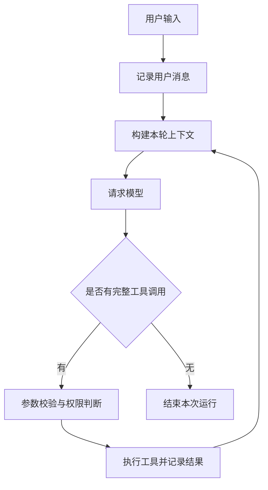

<p align="center">
  
</p>

# KOTTO · 扣仔

**一个以 Python 构建的轻量、可扩展 Agent Harness。**

KOTTO 为模型提供上下文、工具与执行环境，管理一次任务从用户输入、模型响应、工具调用到结果返回的全过程。首个应用场景是本地代码仓库中的阅读、修改与验证。

项目借鉴 Pi 的模块化与可扩展思路，独立设计 Python 实现；目前不是 Pi 的兼容实现或移植版本。

> 当前状态：F01 工程与 CLI 已实现，Agent 和真实模型调用尚未实现。已确定首个模型服务为 DeepSeek。完整首版按 [十个功能规格](specs/README.md) 逐项交付；其他能力均为计划。

## 项目要解决什么

模型可以提出行动，但程序仍需要负责工具如何执行、执行结果如何保存、上下文如何组织，以及用户如何中断和接管任务。

KOTTO 把这些职责组织成可嵌入的运行核心。第一版通过 CLI 使用；未来其他应用可以调用同一个核心，而不必依赖终端界面。

## 第一版范围

- 接入一家模型服务，支持流式文本、工具调用和取消。
- 在指定工作目录中读取、搜索、修改文件，并执行验证命令。
- 管理模型与工具之间的执行循环，限制轮数、时间和资源用量。
- 加载项目规则，控制上下文体积，保留任务目标与重要约束。
- 保存会话和工具结果，识别中断后的不确定执行状态。
- 提供交互式 CLI 和结构化事件输出。

多 Agent 调度、Web 界面、远程部署、插件市场与长期记忆属于后续候选能力，尚未承诺实现。

## 项目结构

```text
kotto/
├── README.md
├── pyproject.toml            # 包元数据与构建配置
├── .gitignore
├── specs/                   # 十个功能点规格、实施状态和验收证据
├── LICENSE                  # 代码与技术文档的 MIT 许可
├── BRAND.md                 # 品牌素材单独使用约定
├── docs/
│   ├── architecture.md      # 模块职责、依赖、执行与恢复约定
│   └── assets/
│       └── kotto-avatar.png # README 使用的品牌资源
├── src/
│   └── kotto/
│       ├── __init__.py
│       ├── contracts/      # 跨模块消息、调用结果与事件契约
│       ├── model/          # 模型适配、流式解析与能力描述
│       ├── runtime/        # 执行循环、状态与任务调度
│       ├── tools/          # 工具注册、校验、权限与执行
│       ├── context/        # 上下文装配、项目规则与历史压缩
│       ├── session/        # 日志、附件与恢复
│       ├── extensions/     # 扩展及 Skill 加载，后续实现
│       ├── cli/            # 命令行输入、渲染与交互
│       └── bootstrap.py    # 将配置与具体实现组装到一起
├── tests/
│   ├── README.md           # 后续测试范围与原则
│   └── fixtures/           # 小型测试仓库与固定响应
├── evals/
│   └── README.md           # 真实任务验收案例与评估口径
└── examples/
    └── README.md           # 可运行示例的建设计划
```

当前模块目录仅包含包声明，不预先建立大量空的实现文件。各模块内部拟拆分的文件、职责与接口见 [架构说明](docs/architecture.md)。

## 核心模块

| 模块 | 负责什么 | 主要输出 |
|---|---|---|
| `model` | 与模型服务通信，统一流式事件 | 文本、完整工具调用、结束原因、用量 |
| `runtime` | 决定任务下一步做什么 | Agent 事件与运行结果 |
| `tools` | 在权限与执行环境约束下执行操作 | 结构化工具结果 |
| `context` | 选择并组织本轮模型可见的信息 | 本轮模型输入 |
| `session` | 记录事实、保存附件、恢复历史 | 会话视图与未确认执行项 |
| `extensions` | 注册额外工具、指引与事件订阅 | 受公开接口约束的扩展能力 |
| `cli` | 接收用户操作并展示进度 | 终端交互或 JSON 事件输出 |

## 一次任务如何运行



权限拒绝、工具错误、超时和取消均须显式返回状态。模型完成回答与用户任务验收通过是两个不同事实；只有实际运行的检查才能成为验证证据。

## 技术取舍

- Python 3.11+，使用 `asyncio` 管理异步工作；阻塞文件操作和外部进程需要适当隔离，避免阻塞事件循环。
- 采用单包 `src` 布局，先保持模块清晰；出现独立复用需求后再考虑拆包。
- 接口使用类型标注与必要的 `Protocol`；外部输入仍需运行时校验。
- 第一版单进程、单会话单写入者；工具默认按顺序执行。
- 会话计划使用追加式 JSONL 日志，大型输出独立保存为附件。
- 模型 SDK、CLI 渲染库和参数校验库在对应实现阶段选择；当前没有运行时第三方依赖。

## 安装与当前可用命令

需要 Python 3.11+。建议在虚拟环境中安装：

```bash
python3 -m venv .venv
source .venv/bin/activate
python -m pip install .
kotto --version
kotto doctor --json
```

`python -m kotto` 与 `kotto` 是同一 CLI。无参数显示帮助；当前仅提供版本和 `doctor`，没有 `chat` 或 `run`。

`doctor` 只检查本地配置，不联网、不验证 Key 有效性。配置齐全时返回 0；缺少 Key、工作目录不存在或格式错误时返回 2。`remote_verified` 始终为 false。

## DeepSeek 配置

```bash
export DEEPSEEK_API_KEY='在本机填入你的 Key'
export KOTTO_MODEL=deepseek-flash
export KOTTO_WORKSPACE=.
kotto doctor
```

- `KOTTO_API_KEY`：如果定义，优先于 `DEEPSEEK_API_KEY`；显式空值不会回退。
- `KOTTO_BASE_URL`：默认 `https://api.deepseek.com`，仅接受不带认证信息、查询串和片段的 HTTP(S) 地址。
- `KOTTO_MODEL`：默认 `deepseek-flash`，可改为服务支持的其他模型。
- `KOTTO_WORKSPACE`：默认当前目录，必须为已存在目录。

[.env.example](.env.example) 仅供参考，程序不自动加载 `.env`。不要把真实 Key 提交到 Git。默认地址与模型名依据 [DeepSeek 官方接入文档](https://api-docs.deepseek.com/)；这是配置默认值，不代表当前已实现模型调用。

## 开发与进度

运行当前测试：

```bash
PYTHONPATH=src python3 -m unittest discover -s tests -v
```

[规格索引](specs/README.md) 列出十个功能点及依赖，[实施状态](specs/status.json) 记录验收进度。F01 提交同时包含现有骨架与全部规格；后续每项完成并验证后单独提交 GitHub。最后一项必须通过安装、真实模型、工具及代码任务的集成验收，才能称为完整首版。

下一项 F02：DeepSeek 流式对话。真实服务验证需要用户在运行环境配置 Key，测试夹具结果不能替代真实调用证据。

## 品牌与许可

扣仔形象采用用户选定的第 04 版。本仓库保留 README 所依赖的头像副本；完整品牌源素材位于工作区的 `04-影响力/00-扣仔品牌`。

代码与技术文档使用 [MIT](LICENSE)。扣仔品牌视觉素材不在代码 MIT 授权范围内，参见 [品牌使用约定](BRAND.md)。
